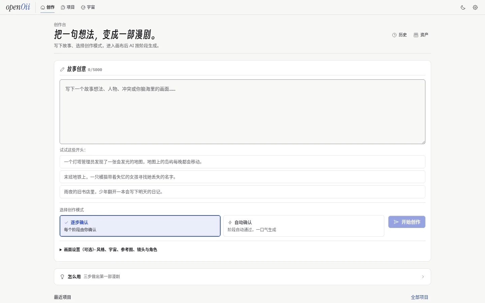
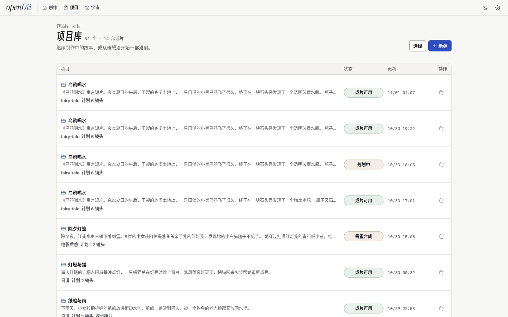
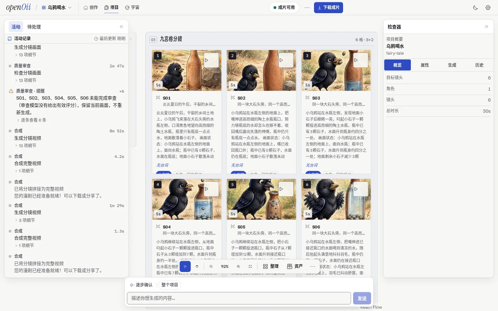
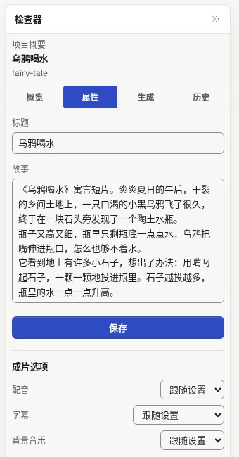
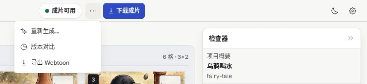
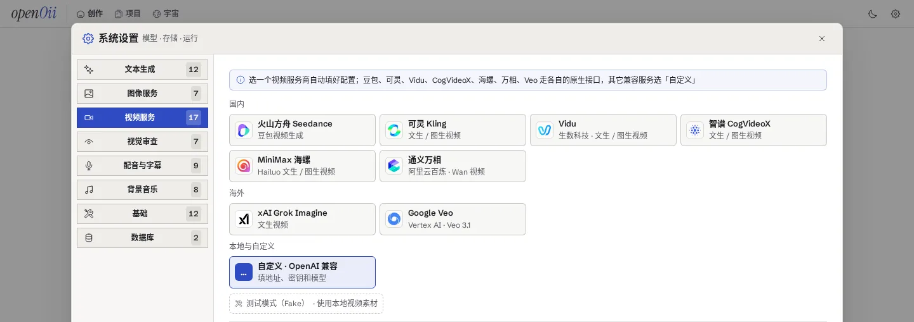
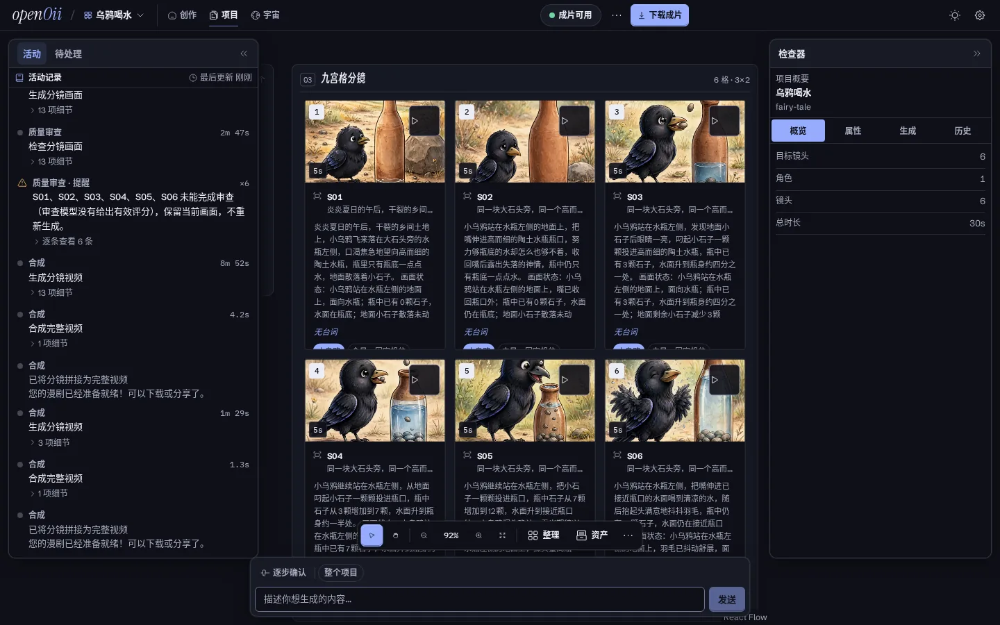
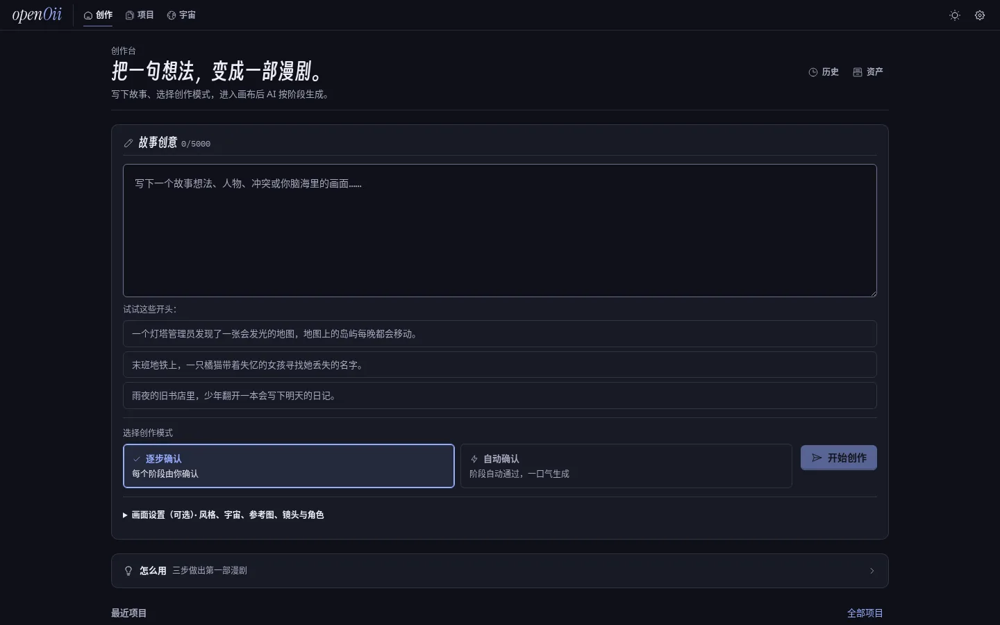

# openOii

<div align="center">
  

  <p><strong>故事想法 → 分阶段生成 → 漫剧成片</strong></p>
  <p>一个基于 <a href="https://github.com/badlogic/pi-mono">pi</a>（pi-ai）的 AI 漫剧生成学习项目：15 阶段确定性工作流 + 审批门 + 视觉审查。</p>

  <p>
    
    
    
    
  </p>


  <p>
    <a href="#功能">功能</a> ·
    <a href="#界面预览">界面预览</a> ·
    <a href="#架构">架构</a> ·
    <a href="#快速开始">快速开始</a> ·
    <a href="#项目结构">项目结构</a>
  </p>
</div>

## ☁️ 赞助商 · Bloome

<table>
  <tr>
    <td align="center" width="58%" valign="top">
      <a href="https://bloome.im/app?utm_medium=github&utm_source=Xeron2000-openOii-ivor-202607">
        
      </a>
    </td>
    <td width="42%" valign="middle">
      <p>也在研究像 <strong>openOii</strong> 这样的分阶段 AI 工作流？</p>
      <p>
        <a href="https://bloome.im/app?utm_medium=github&utm_source=Xeron2000-openOii-ivor-202607"><strong>Bloome</strong></a>
        让 Claude、ChatGPT、DeepSeek 等多个 AI 在同一对话里协作——互相质疑、交叉核对、一起把结果打磨到位。
      </p>
      <ul>
        <li>零配置，云端即用</li>
        <li>网页与移动端均可使用</li>
        <li>配置好的 Agent 可分享给团队</li>
      </ul>
      <p><strong>👉 <a href="https://bloome.im/app?utm_medium=github&utm_source=Xeron2000-openOii-ivor-202607">免费试用 Bloome</a></strong></p>
    </td>
  </tr>
</table>

openOii 把一句故事想法变成一部带配音、字幕和背景音乐的漫剧短片：先规划大纲、角色和分镜，再出角色形象和分镜画面，经过质量审查后生成视频并合成成片。整个过程在一块画布上进行，每个阶段都可以停下来确认、反馈或重来。

> [!WARNING]
> 这是一个**多阶段工作流的学习 / 演示项目**（Node 工作流引擎 + FastAPI + 共享 SQLite），重点是验证阶段编排、审批门、断点恢复、实时进度和前后端协作。
> **不适合直接用于生产环境。**

## 功能

- **一句话开始创作**：首页写下故事，选风格、故事宇宙（把多部作品的角色和世界观串在一起）和参考图；「逐步确认」模式每个阶段都等你确认，「自动确认」一口气跑完。
- **15 阶段流水线、6 个审批门**：大纲 → 角色 → 分镜 → 角色形象 → 分镜画面 → 视频片段 → 合成成片。运行可以取消、从中断的阶段继续，也可以针对某一步提反馈后只重跑受影响的部分。
- **质量审查与一致性**：角色形象和分镜画面生成后，由视觉模型检查一致性、质量和构图，并用人脸特征比对同一角色在各镜头里是否一致；不合格的会提示或重画。
- **成片选项**：每个项目可以单独开关**配音**、**字幕**（不要字幕 / 软字幕 / 烧进画面）和**背景音乐**，也可以「跟随设置」；角色可以指定配音音色。
- **服务商预设**：设置里按文本、图像、视频、视觉审查、配音、背景音乐分页，选一张卡片就填好地址、接口和推荐模型，只剩密钥自己填。视频支持火山方舟 Seedance、可灵、Vidu、智谱 CogVideoX、MiniMax 海螺、通义万相、Google Veo、xAI Grok Imagine 和任意 OpenAI 兼容服务；每类都有「测试模式（Fake）」，不调外部接口也能跑通全流程。详见 [docs/providers.md](docs/providers.md)。
- **画布工作台**：React Flow 画布展示角色和分镜卡片；左侧是活动记录和待处理事项，右侧检查器可以改标题、故事、角色和镜头，顶栏有版本对比、历史和资产抽屉。
- **导出**：成片完成后可以直接下载视频，或导出 Webtoon 长图（后端也提供 PDF 导出接口）。
- **实时进度**：WebSocket 推送每个阶段的进度和事件，刷新页面或断线重连后状态不丢；支持浅色 / 深色主题。

## 界面预览

<table>
  <tr>
    <td align="center" width="50%">
      
      <br />
      <sub><strong>首页 · 写下故事，选择逐步确认或自动确认</strong></sub>
    </td>
    <td align="center" width="50%">
      
      <br />
      <sub><strong>项目库 · 每个项目的状态一目了然</strong></sub>
    </td>
  </tr>
  <tr>
    <td align="center" colspan="2">
      
      <br />
      <sub><strong>工作台 · 活动记录（含质量审查评分）、分镜画布与检查器</strong></sub>
    </td>
  </tr>
  <tr>
    <td align="center" width="50%">
      
      <br />
      <sub><strong>成片选项 · 配音 / 字幕 / 背景音乐</strong></sub>
    </td>
    <td align="center" width="50%">
      
      <br />
      <sub><strong>导出 · 下载成片、导出 Webtoon、版本对比</strong></sub>
    </td>
  </tr>
  <tr>
    <td align="center" colspan="2">
      
      <br />
      <sub><strong>设置 · 视频服务商预设（文本、图像、视觉审查、配音、背景音乐同样有预设）</strong></sub>
    </td>
  </tr>
  <tr>
    <td align="center" width="50%">
      
      <br />
      <sub><strong>深色主题 · 工作台</strong></sub>
    </td>
    <td align="center" width="50%">
      
      <br />
      <sub><strong>深色主题 · 首页</strong></sub>
    </td>
  </tr>
</table>

## 快速开始

需要 Python 3.10+ 与 [uv](https://docs.astral.sh/uv/)、Node.js 22+ 与 pnpm，以及 FFmpeg（合成视频用）。

### 1. 配置

```bash
cp backend/.env.example backend/.env
```

想先不花钱跑通全流程，把文本、图像、视频的 provider 设为 `fake`（`TEXT_PROVIDER=fake`、`IMAGE_PROVIDER=fake`、`VIDEO_PROVIDER=fake`，视频还要填一个 `FAKE_VIDEO_FIXTURE_*`）。之后也可以在网页「设置」里选服务商预设、填密钥，大部分配置保存后立即生效。

### 2. 启动三个服务

```bash
# 后端 API（:18765，启动时自动迁移数据库）
cd backend
uv sync
uv run uvicorn app.main:app --reload --host 127.0.0.1 --port 18765

# 编排引擎（:18766，只监听本机，与后端共用同一个 SQLite 文件）
cd engine
pnpm install
ENGINE_DB_PATH=../backend/data/openoii.db \
ENGINE_BACKEND_DIR=../backend \
ENGINE_STATIC_DIR=../backend/app/static \
ENGINE_PYTHON=../backend/.venv/bin/python \
pnpm dev

# 前端（:15173）
cd frontend
pnpm install
pnpm dev
```

打开 http://localhost:15173 ，API 文档在 http://localhost:18765/docs 。

### Docker

```bash
cp backend/.env.example backend/.env
docker compose up -d
```

后端镜像里同时打包了编排引擎；前端同样在 http://localhost:15173 。

## 常用命令

```bash
# 后端
cd backend && uv run pytest && uv run ruff check app tests

# 引擎
cd engine && pnpm test && pnpm typecheck

# 前端
cd frontend && pnpm test && pnpm build   # build 会检查 JS 体积预算
cd frontend && pnpm e2e                  # Playwright 端到端测试
```

## 架构

openOii 不是多智能体系统，而是一条**确定性的工作流**：

- **15 个阶段、6 个审批门**：大纲 → 角色 → 分镜 → 角色形象 → 分镜画面 → 视频片段 → 合成成片，每一步产出后都可以停下来审批、修改或重跑。阶段顺序由引擎里的状态机（`engine/src/pipeline/runner.ts`）决定，不由模型决定。
- **每个阶段是一个普通函数**：大纲、角色、分镜调用文本模型并按结构化格式解析；角色形象和分镜画面调用图像模型；视频片段调用视频模型，再交给后端用 FFmpeg 拼接、加字幕、配音和背景音乐。
- **视觉审查（critic）**：图像生成后由视觉模型检查角色一致性和画面问题，不合格的会自动重画。
- **模型调用基于 [pi](https://github.com/badlogic/pi-mono) 的 `pi-ai`**（统一的多服务商 LLM 接口），负责文本与视觉模型的流式调用、思考强度和用量统计；图像、视频、语音走各服务商自己的接口，见 [docs/providers.md](docs/providers.md)。
- 代码和界面里的 outline / plan / render / critic / compose 只是阶段分组的名字，不是各自循环、互相对话的独立 agent。引擎在 `engine/src/agent/` 预留了一个有步数上限、可取消的 agent loop 接口，目前没有接入流水线。

## 项目结构

```text
backend/    FastAPI + SQLModel：HTTP / WebSocket 接口、配置、导出，以及给引擎调用的图像拼接、配音、背景音乐、人脸比对工具
engine/     Node/TypeScript 工作流引擎：阶段机、审批门、重试与恢复、运行租约和事件，是唯一决定「下一步做什么」的地方
frontend/   React 18 + TypeScript + React Flow 画布工作台
contracts/  前后端与引擎共享的工作流契约（scripts/generate_workflow_contract.py 生成代码）
docs/       架构决策、服务商说明（providers.md）等文档
```

架构约束见 [AGENTS.md](AGENTS.md)：引擎是唯一的编排运行时，FastAPI 只做产品后端和引擎网关。

## 技术栈

- 前端：React 18、TypeScript、React Flow、TanStack Query、Zustand、Tailwind CSS
- 后端：FastAPI、SQLModel、Alembic
- 引擎：Node.js + TypeScript，模型调用用 [pi-ai](https://github.com/badlogic/pi-mono/tree/main/packages/ai)（`@mariozechner/pi-ai` 0.73）
- 存储：单文件 SQLite（WAL）+ `/static` 媒体目录

## 🙏 致谢

- [Linux.do](https://linux.do/) - 强烈推荐！高质量技术社区，感谢佬友们的公益站和热心支持 ❤️

## License

MIT
